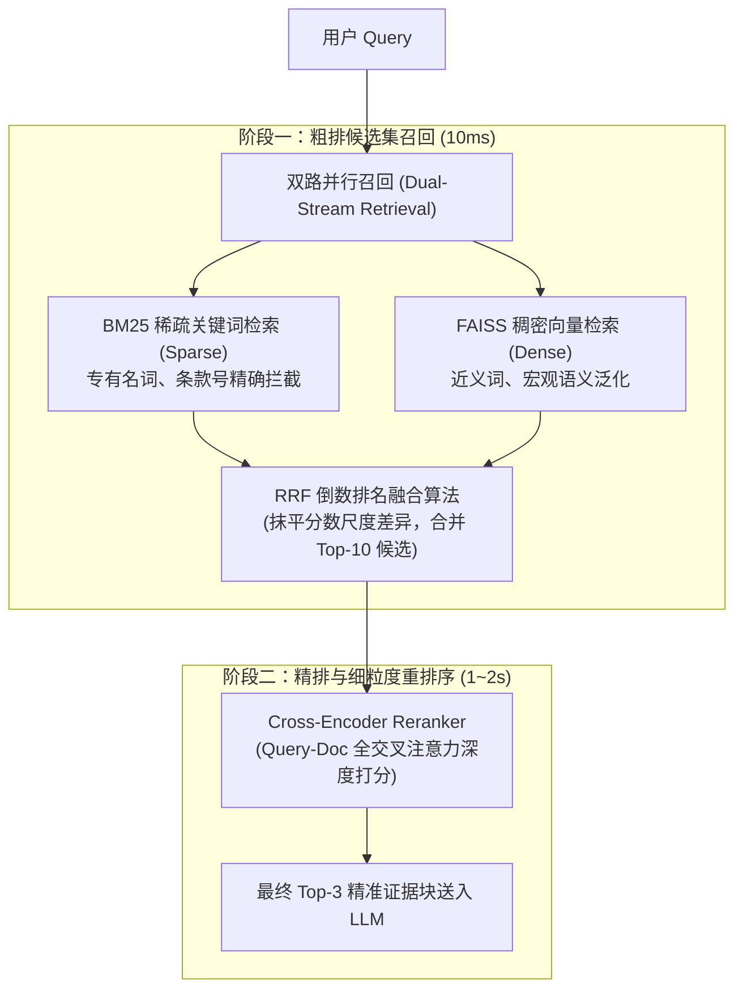

# Day 09 · Advanced RAG：混合检索与重排 (Hybrid Search & Reranking) 深度复盘笔记

> 日期：2026-11-11（周三）｜ 学习日：Day 09 / 60 ｜ 状态：已完成  
> 阶段：第 2 周 · Advanced RAG 与生产级向量数据库  
> 代码归档：[`day09.py`](file:///d:/Study/AgentGuide/learning/Daily/Day-09-HybridSearch-Rerank/day09.py)

---

## 一、 核心知识点与架构心智模型

生产级 RAG 架构必须采用**两阶段检索漏斗（Two-Stage Retrieval Funnel）**，彻底打破单一 Dense 向量检索的瓶颈：

### 1. BM25（稀疏检索 / Sparse）vs Dense Embedding
- **特征空间**：
  - **BM25**：基于词频（TF）、逆文档频率（IDF）以及文档长度归一化（惩罚过长文档），词频增长具备饱和度上限；擅长**硬匹配**，对专有名词、规章条款编号（“第七条”、“司局级”）极度敏感。
  - **Dense Embedding**：双塔 Bi-Encoder 独立将 Query 和 Doc 映射为低维固定向量（1024 维）；擅长**软匹配（语义近义泛化）**，但容易发生“条款号语义漂移”（分不清第三条与第七条）。

### 2. RRF (Reciprocal Rank Fusion，倒数排名融合) 算法
- **核心公式**：
  $$RRF\_Score(d) = \sum_{m \in M} \frac{1}{k + rank_m(d)}$$
- **工业界设计精髓**：
  - **抹平异构分数尺度**：BM25 得分通常是 $0 \sim 30+$ 的无界统计分，Dense 相似度通常是 $-1.0 \sim 1.0$ 的余弦值。两者绝对数值不可比，RRF 丢弃绝对分数，只看各系统内的**相对名次（Rank）**。
  - **共识增益（Consensus Boost）**：若某文档在 BM25 与 Dense 均名列前茅（如双第 1 名），得分叠加为 $\frac{1}{61} + \frac{1}{61} \approx 0.0328$，远超单路第一名（$0.0164$），实现双路共识的稳健置顶。
  - **平滑常数 $k=60$**：学术与工业界黄金默认值，能有效平滑长尾排名的断崖式衰减。

### 3. Cross-Encoder (单塔交叉编码器) vs Bi-Encoder (双塔)
- **底层注意力机制**：
  - **Bi-Encoder**：Query 与 Doc 分别编码，只有各自内部的 Self-Attention，最终只靠几何点积打分，丢失细粒度逻辑关系。
  - **Cross-Encoder**：输入 `[CLS] Query [SEP] Doc [SEP]`，所有 Token 进行 **Full Cross-Attention（全交叉注意力）**，能精准捕捉逻辑否定、限制条件和细微数值。
- **`[CLS]` 与 `[SEP]` 机制**：
  - `[SEP]` 充当句子边界隔断；
  - `[CLS]` 作为一个无词义偏见的容器，在逐层注意力交互中**完整吸收了全场两句之间的匹配度判决信息**，最后由线性分类头输出一个 $0 \sim 1$ 之间的标量分数。

---

## 二、 真实 A/B 对照实验与参数调优实战

在《中央和国家机关差旅费管理办法》真实公文语料上进行 A/B 测试：

### 1. 横向策略表现对比（Top-10 候选池）

| 测试 Query | 策略 | Top-1 命中片段 | 得分 | 耗时 (ms) | 动作洞察 |
|---|---|---|---|---|---|
| **Q1: 《差旅费管理办法》第七条规定了什么交通工具？** | 1. Pure Dense | [Chunk 1] 第三条（差旅费定义） | 0.7156 | 11.56 ms | 条款号漂移，误中第三条 |
| | 2. Pure BM25 | [Chunk 11] 附则（管理办法解释权） | 7.2966 | 0.45 ms | **词频污染**，“管理办法/规定”带偏 |
| | 3. Hybrid (RRF) | [Chunk 11] 附则 | 0.032266 | 7.57 ms | 受词频干扰，延续粗排误判 |
| | **4. Hybrid + Rerank** | **[Chunk 2] 第二章 第六/七条（交通工具表）** | **0.9928 🚀** | **2025.81 ms** | **精排大逆转！连跨 7 个身位校正置顶真值** |
| **Q2: 普通员工出差去北京，坐高铁能买一等座吗？** | 1. Pure Dense | [Chunk 2] 第二章 交通工具等级表 | 0.5786 | 7.83 ms | 双路共识命中 |
| | 2. Pure BM25 | [Chunk 2] 第二章 交通工具等级表 | 10.9598 | 0.34 ms | 强关键词命中 |
| | 3. Hybrid (RRF) | [Chunk 2] 第二章 交通工具等级表 | 0.032787 | 6.61 ms | 满血共识置顶 |
| | **4. Hybrid + Rerank** | **[Chunk 2] 第二章 交通工具等级表** | **0.9141** | **2039.57 ms** | **精排高分锁定，确认正确** |
| **Q3: 去外地出差，每天伙食费能给补助多少钱？** | 1. Pure Dense | [Chunk 5] 第十六条 伙食补助费 | 0.7734 | 7.55 ms | 语义高分命中 |
| | 2. Pure BM25 | [Chunk 5] 第十六条 伙食补助费 | 3.3456 | 0.36 ms | 关键词命中 |
| | 3. Hybrid (RRF) | [Chunk 5] 第十六条 伙食补助费 | 0.032787 | 7.90 ms | 满血共识置顶 |
| | **4. Hybrid + Rerank** | **[Chunk 5] 第十六条 伙食补助费** | **0.9933** | **1974.51 ms** | **接近满分置信度，极其稳定** |

### 2. 核心实验发现：候选池大小（Top-5 vs Top-10）与精度/延迟权衡

- **Top-5 候选池实测**：
  - Rerank 耗时：`~800ms`；
  - 现象：`Chunk 2`（带表格长分块，受 BM25 长度惩罚排第 6、Dense 排第 8）被粗排截断在门外，Cross-Encoder 只能在被污染的候选里将次优的 `Chunk 1` 置顶（0.9699 分）。
- **Top-10 候选池实测**：
  - Rerank 耗时：`~2000ms`（耗时线性翻倍）；
  - 现象：`Chunk 2` 成功进入精排候选池，Cross-Encoder 瞬间打出 **0.9928** 的统治级高分，**直接连跨 7 个身位上演绝地反超，完美命中 Ground-Truth！**
- **生产权衡结论**：漏斗开口决定召回上限，候选池数量与推理延迟呈严格正比。

---

## 三、 实战避坑实录与排错经验（Troubleshooting）

1. **Pydantic 模型引用传递与原地修改副作用（In-Place Mutation）**：
   - *现象*：在 `cross_encoder_rerank` 中如果执行 `candidates[k].score = score`，由于对象是指针引用，会导致传入的 `hybrid_res` 的 RRF 原始分数被直接篡改，破坏了后续 A/B 对比评测的真实性。
   - *方案*：采用不可变复制 `cand.model_copy(update={"score": float(score)})`，保证纯函数无副作用。
2. **`dict_items` 视图切片报 `TypeError`**：
   - *现象*：Python 3 中 `rrf_scores_sorted.items()[:top_k]` 报错 `'dict_items' object is not subscriptable`。
   - *方案*：显式包裹 `list(rrf_scores_sorted.items())[:top_k]` 后再进行切片。
3. **RRF 排名起点必须从 1 开始**：
   - *现象*：`enumerate(rankings)` 默认从 0 开始，导致第 1 名的分数变为 $\frac{1}{60+0}$，与论文标准公式 $\frac{1}{60+1}$ 偏离。
   - *方案*：显式声明 `enumerate(rankings, start=1)`。
4. **BM25 词频虚高与背景词污染（Query Term Overshadowing）**：
   - *现象*：公文末尾附则因为高频出现“差旅费管理办法”、“规定”，把真正需要查找的“第七条”相关度掩盖。
   - *启示*：生产环境中需结合轻量停用词过滤，或配合 Cross-Encoder 提供终极语义兜底。

---

## 四、 面试级追问与架构思考

### Q1：为什么生产级系统中不能直接用 Cross-Encoder 做全库检索？
- **核心要点**：
  1. **时间与算力复杂度**：Bi-Encoder 的计算量是 $O(1)$ 或通过 HNSW 近似搜索 $O(\log N)$，文档向量可在离线阶段全部预先计算完毕；而 Cross-Encoder 无法离线预存，必须在线拼接 Query 和 Doc 进行 $O(N)$ 轮深度 Transformer 推理。
  2. **并发与延迟崩溃**：全库若有 10 万个分块，计算一次单条 Query 需耗费几分钟甚至导致 GPU 显存爆仓（OOM）。两阶段漏斗架构将候选量从 10 万直接收敛到 10~20，将推理时间压缩在 1 秒以内。

### Q2：当 RRF 融合时，如果某一类检索器（如 Dense 向量）的表现普遍显著优于稀疏检索，无参数的 RRF 还能保持最优吗？该如何调优？
- **核心要点**：
  1. **RRF 的局限性**：标准 RRF 假设各路系统是完全平等的（权重均为 1.0）。如果业务场景对语义泛化要求极高，纯关键词检索经常引入噪声，标准 RRF 可能会被劣质检索器拖累。
  2. **加权 RRF（Weighted RRF）**：引入检索器权重系数 $w_m$：
     $$RRF\_Score(d) = \sum_{m \in M} w_m \cdot \frac{1}{k + rank_m(d)}$$
     例如设置 $w_{dense} = 0.7, w_{bm25} = 0.3$。
  3. **动态阈值裁剪（Score Threshold Pruning）**：在各路进入 RRF 之前，先剔除绝对分数低于特定安全阈值的候选块，防止低质结果进入排名。
