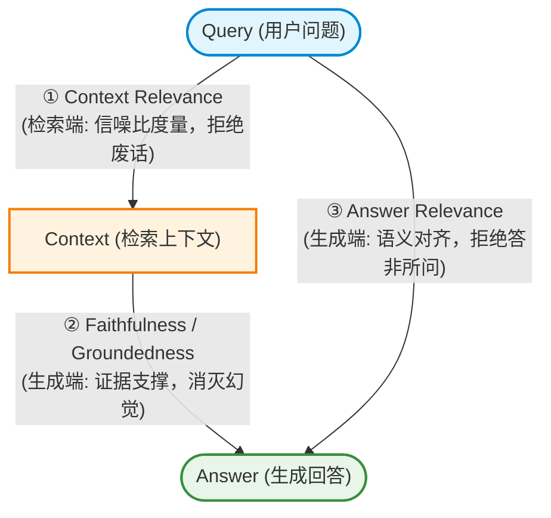

# Day 10 · Advanced RAG：RAG 科学评估体系与 Ragas 实战深度复盘笔记

> 日期：2026-11-16（周一）｜ 学习日：Day 10 / 60 ｜ 状态：已完成  
> 阶段：第 2 周 · Advanced RAG 与生产级向量数据库  
> 代码归档：[`day10.py`](file:///d:/Study/AgentGuide/learning/Daily/Day-10-RAG评估体系/day10.py)

---

## 一、 核心知识点与架构心智模型

在工业级 RAG 生产落地中，传统字面重叠度指标（BLEU / ROUGE）由于无法捕捉语义等价性而彻底失效，人工盲测抽检更存在不可忽视的幸存者偏差。Day 10 核心掌握了 **RAG Triad（三元评估心智模型）** 与 **LLM-as-a-Judge（大模型裁判）** 科学量化评测体系。

### 1. RAG Triad 三元解耦模型
RAG Triad 将评测解耦为检索端与生成端两个独立阶段：



- **Context Relevance（上下文相关度）**：衡量检索出的 Chunks 中有用信息占总文本的比例，防止无用信息污染上下文窗口或引发“Lost in the Middle”。
- **Faithfulness（忠实度 / 抗幻觉）**：回答中的事实陈述是否完全由参考资料推导而来。
- **Answer Relevance（回答相关度）**：回答是否切中用户的问题痛点，避免顾左右而言他。

### 2. Faithfulness 的两阶段原子化拆解（Ragas 核心机制）
1. **原子命题拆解（Atomic Statements Extraction）**：
   将复杂的长答案拆解为一组不可再分的独立事实陈述句 $T(A) = \{t_1, t_2, \dots, t_n\}$。
2. **自然语言推理蕴含判定（NLI-based Verification）**：
   裁判大模型针对每一条命题，依据参考资料做二元逻辑蕴含检验（$Verdict \in \{0, 1\}$）：
   $$Faithfulness = \frac{\sum_{j=1}^n \mathbb{I}(C \models t_j)}{n}$$

### 3. Answer Relevance：逆向问题生成机制（Reverse Question Generation）
- **为什么不直接算 $\cos(E(Q), E(A))$？**
  提问 $Q$ 与回答 $A$ 在句式语法与语义空间上高度非对称（短疑问句 vs 长篇陈述句），直接计算余弦相似度无法准确衡量切题度。
- **逆向提问法原理**：
  若回答切中问题，仅凭回答本身，裁判模型就能反向推导出当初用户问了什么：
  $$Answer\_Relevance = \frac{1}{m} \sum_{j=1}^m \frac{E(Q) \cdot E(q'_j)}{\|E(Q)\| \|E(q'_j)\|}$$

---

## 二、 真实 Benchmark 对照实验量化台账

在本地裁判大模型（兼容 OpenAI 协议）与 `BAAI/bge-small-zh-v1.5` 嵌入模型驱动下，实测两组典型 Benchmark 样本：

| 样本类别 | 提问 Query | 生成回答 Answer 摘要 | Faithfulness（忠实度） | Answer Relevance（相关度） | 耗时 | 判定结果洞察 |
|---|---|---|---|---|---|---|
| **样本 1（差旅合规回答）** | 普通员工出差去北京，坐高铁能买一等座吗？ | 普通员工出差不能买一等座，只能买二等座，一等座仅限司局级乘坐。 | **0.6667** | **0.7327** | 16.34s | **成功捕获过度推断**：原规则规定司局级可乘一等座，但未排他限制部级人员能否乘坐，回答中“仅限”被敏锐判为无依据幻觉。 |
| **样本 2（典型虚构幻觉）** | 出差人员乘坐高铁有什么等级限制？ | 可以根据需要买特等座或商务座，每人每天享 800 元豪华伙食补助，住宿不设上限。 | **0.0000 🔴** | **0.6984** | 11.04s | **精准断罪**：虚构特等座、编造 800 元伙食费、谎称住宿无上限三项命题全部被判定为 0（触发严重幻觉告警）。 |

### 样本 1 命题判定明细：
- ✅ 支撑 ｜ 「普通员工出差不能购买高铁一等座」
  - 理由：参考资料明确规定司局级可乘一等座、其余人员（含普通员工）可乘二等座，普通员工不在一等座范围内。
- ✅ 支撑 ｜ 「普通员工（其余人员）出差乘坐高铁时只能购买二等座」
  - 理由：参考资料表明其余人员可乘高铁二等座，只能选择二等座。
- ❌ 幻觉 ｜ 「高铁一等座仅限司局级及相当职务人员乘坐」
  - 理由：参考资料只是说司局级及相当职务人员可乘高铁一等座，并没有表明“仅限”司局级人员，属于无原文支撑的过度推断。

### 样本 2 命题判定明细：
- ❌ 幻觉 ｜ 「出差人员乘坐高铁可以根据需要购买特等座或商务座。」
  - 理由：参考资料明确规定部级乘商务座、司局级乘一等座、其余人员乘二等座，未提及特等座，亦非“根据需要”随意购买。
- ❌ 幻觉 ｜ 「出差每人每天可享受800元豪华伙食补助费。」
  - 理由：资料未涉及任何伙食补助金额。
- ❌ 幻觉 ｜ 「住宿不设上限。」
  - 理由：资料未提及住宿费用上限相关内容。

---

## 三、 实战踩坑与排错记录（Bug Hunting）

### 踩坑 1：负样本明细被静默吞没（Data Loss Bug）
- **现象**：在样本 2 执行后，得分显示为 0.0000，但控制台 `[命题支撑判定明细]:` 为空。
- **根因**：在 `evaluate_faithfulness` 中原代码写为：
  ```python
  for res in json.loads(out):
      if res["verdict"]:
          supported_count += 1
          verification_list.append(...)
  ```
  `if res["verdict"]:` 将判决为 0 的命题直接过滤掉，导致没有将未支撑的命题及其 `reason` 存入报告。
- **修复**：解耦统计与追加，全量记录裁判结果：
  ```python
  v = int(res.get("verdict", 0))
  if v == 1:
      supported_count += 1
  verification_list.append(StatementVerification(statement=res["statement"], verdict=v, reason=res["reason"]))
  ```

### 踩坑 2：硬编码 `verdict=1` 引发的“视觉反差萌”（Visual Bug）
- **现象**：捞回所有判定明细后，样本 2 明明得 0 分且理由写着“无法推导”，但前面图标全部挂着 `✅ 支撑`。
- **根因**：在 `StatementVerification` 构造中硬编码了 `verdict=1`。
- **修复**：传入动态提取的判定值 `verdict=v`，保证状态与分数严格统一。

---

## 四、 工业级生产建议与大厂面试高频考察

### Q1：在线系统高并发（QPS > 1000）下，如何平衡 LLM-as-a-Judge 的延迟与成本？
- **分层采样架构（Tiered Sampling）**：线上只对 1%~5% 的生产流量进行全量异步抽样送检，避免阻塞实时接口。
- **小模型离线精炼（Distillation & Cross-Encoder）**：用开源大模型或大模型蒸馏出轻量级判定模型（如小型 DeBERTa / RoBERTa NLI 分类器），单句推理延迟可降至 5ms 以内，单卡即可抗住高 QPS。
- **规则与关键词前置过滤器**：在调用 LLM 裁判前，先用正则与敏感实体拦截已知非法模式。

### Q2：如何防御大模型裁判的“内生偏见（Intrinsic Biases）”？
1. **位置偏见（Position Bias）**：在 A/B Pairwise 对比中，执行位置翻转（A/B 与 B/A）双向推理；
2. **冗长偏见（Verbosity Bias）**：采用 Ragas 原子命题拆解，使字数长短不再作为整体打分的干扰项；
3. **温度漂移（Temperature Drift）**：必须将裁判模型温度锁死在 `temperature=0.01`，确保打分绝对可复现。
