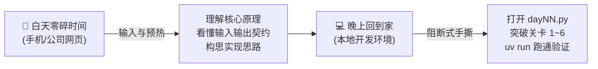

# 🤖 AI Agent 开发工程师 · 60 天工程实战

> **面向生产环境的 AI Agent & Advanced RAG 进阶之旅**  
> 坚持“白天心智预演（手机/网页预读）+ 晚上手撕收网（本地编码真机实测）”的黄金学习范式。

---

## 🧭 学习工作流

- **白天摸鱼 / 通勤（15~20 分钟）**：阅读当天的【学习任务卡】，搞清楚核心痛点（Why）、技术演进（What）、输入输出契约与架构图，在潜意识里完成构思。
- **晚上到家（30~45 分钟）**：无需在疲惫时啃长篇大论，直接运行 `uv run python learning/Daily/Day-NN-xxx/dayNN.py`，顺着 TODO 关卡一步步手撕实现并跑通测试。

---

## 🗺️ 阶段全景路线图

| 周次 | 阶段主题 | 核心内容 | 阶段产出 |
| :--- | :--- | :--- | :--- |
| **第 1 周** | 大模型应用开发基础 + Naive RAG | FastAPI、LangChain、FAISS、端到端接口 | ✅ Naive RAG Docker 容器化闭环 |
| **第 2 周** | Advanced RAG 与生产级向量库 | Query 改写 (HyDE/Multi-Query)、混合检索、RAGAs 评估、Milvus | 🚀 工业级高精度检索升级 |
| **第 3 周** | Agent 开发与 Tool Calling | ReAct 闭环、自定义工具、Function Calling、Memory、容错降级 | 🤖 “研究助手”智能 Agent |
| **第 4 周** | 系统性能优化与高并发 | Redis 缓存、异步并发 (Async)、批处理、vLLM 高性能推理 | ⚡ 压测与 P99 延迟报告 |
| **第 5 周** | 监控、可观测性与生产部署 | LangSmith 链路追踪、Prometheus 指标、Grafana 大盘、Compose | 📊 生产级可观测性监控大盘 |
| **第 6 周** | Multi-Agent 多智能体协同 | AutoGen、CrewAI 框架实战与多角色协同 | 👥 自动化投研多 Agent 团队 |
| **第 7-8 周** | 工业级项目实战与面试冲刺 | 智能客服 RAG、投研 Agent 实战、简历量化与 Mock 面试 | 🏆 2套完整项目实战成果 |

---

## ⚡ 常用快捷入口

- 📋 [**60 天完整落地路线图**](learning-roadmap.md)
- 📈 [**学习进度追踪与打卡表**](learning-progress.md)
- 🗂️ [**今日任务卡 (Day 08)**](learning-cards/Day-08-QueryTransformation.md)
