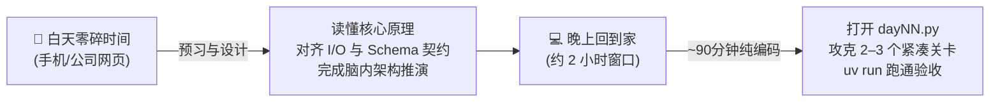

# 🤖 AI Agent 开发工程师 · 60 天工程实战

> **面向生产环境的 AI Agent & Advanced RAG 进阶之旅**  
> 坚持“**白天心智预演（概念理解 + Schema/架构设计）+ 晚上 2 小时夜间里程碑（~90 分钟零阻力纯编码与真机验收）**”的黄金学习范式。

---

## 🧭 学习工作流

- **白天摸鱼 / 通勤（15~25 分钟）**：阅读当天的【学习任务卡】，提前完成概念理解与 Schema/架构设计（周末提前备好所需 ISP 文档或测试图片）。
- **晚上到家（约 2 小时，有效编码+调试 ~90 分钟）**：无需临时啃文档或重装重型环境，直接运行 `uv run python learning/Daily/Day-NN-xxx/dayNN.py`，只攻克 **1 个单一、可验证的闭环模块**。

---

## 🗺️ 阶段全景路线图

| 周次 | 学习日范围 | 阶段主题 | 核心内容 | 阶段产出 |
| :--- | :--- | :--- | :--- | :--- |
| **第 1 周** | Day 1–7 | 大模型应用开发基础 + Naive RAG | FastAPI、LangChain LCEL、FAISS、端到端接口 | ✅ Naive RAG Docker 容器化闭环 |
| **第 2 周** | Day 8–14 | Advanced RAG 与生产级向量库 | Query 改写 (HyDE/Multi-Query)、混合检索、RAGAs、Milvus | ✅ 工业级高精度检索升级 |
| **第 3 周** | Day 15–21 | Agent 开发、Context Engineering 与 MCP | ReAct、Tool Calling、Text-to-SQL、Function Calling、上下文工程、熔断护栏、MCP | 🤖 「ISP 研究助手」+ 最小 MCP Server |
| **第 4–5 周** | Day 22–29（8 晚） | 工程性能、流式交互、可观测与部署 | cProfile、Prompt Caching + Redis、Async/SSE、Batching、Langfuse Cloud + Prometheus + structlog、Compose + Locust | ⚡ Docker Compose 全栈 + Locust QPS/P99 报告 |
| **第 6 周** | Day 30–37（8 晚） | LangGraph + VLM 多模态 + Agent Eval | LangGraph（路由/ToolNode/HITL/Subgraph）、VLM初筛+算子复核（MCP）、Golden Dataset + 离线评测 | 🧠 可中断多模态诊断编排与离线 Eval 基线 |
| **第 7–8 周** | Day 38–60（23 晚） | 工业级项目实战与面试冲刺 | 项目一（8晚：ISP 专家 RAG）、项目二（11晚：画质自动诊断 Agent）、简历量化 + 架构图 + 系统设计 + Mock（4晚） | 🏆 2 套专属计算摄影×AI 护城河代表作 |

---

## ⚡ 常用快捷入口

- 📋 [**60 天完整落地路线图**](learning-roadmap.md)
- 📈 [**学习进度追踪与打卡表**](learning-progress.md)
- 🗂️ [**今日任务卡 (Day 18)**](learning-cards/Day-18-FunctionCalling实战.md)
